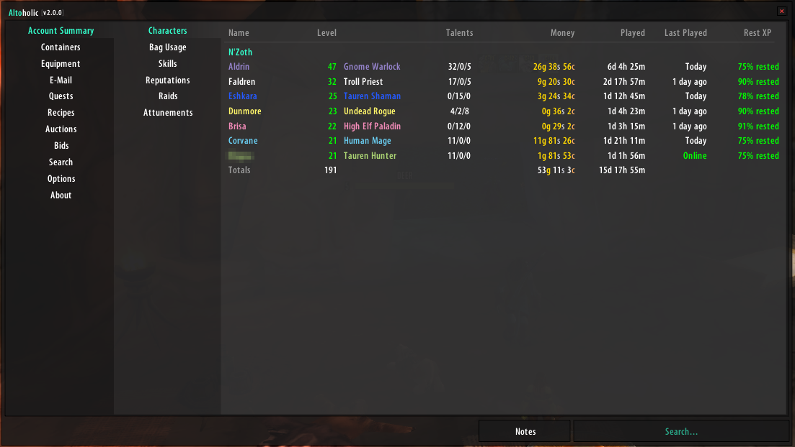
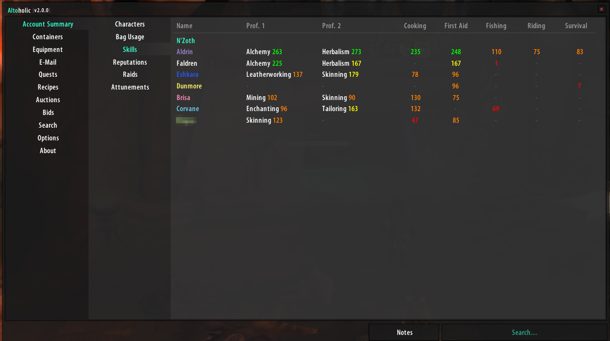
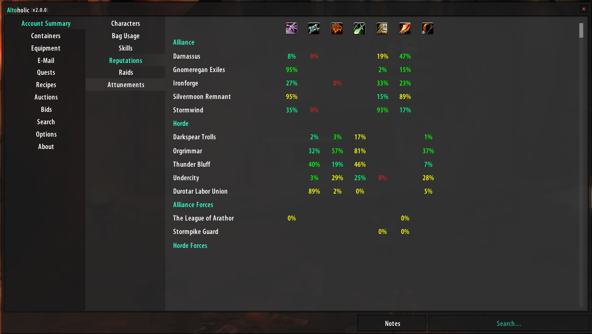
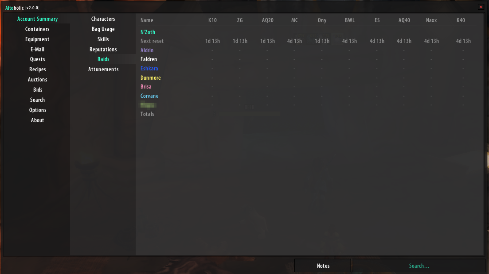
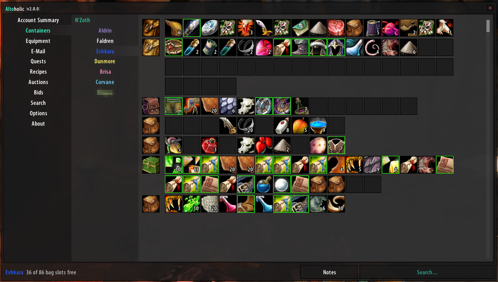
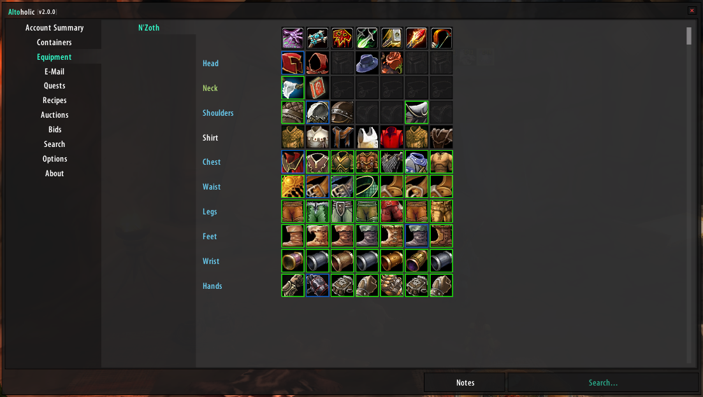
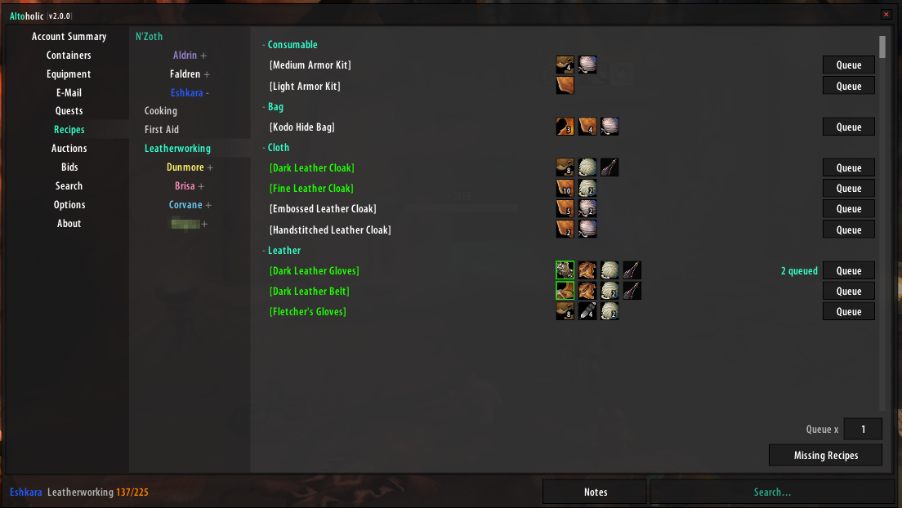
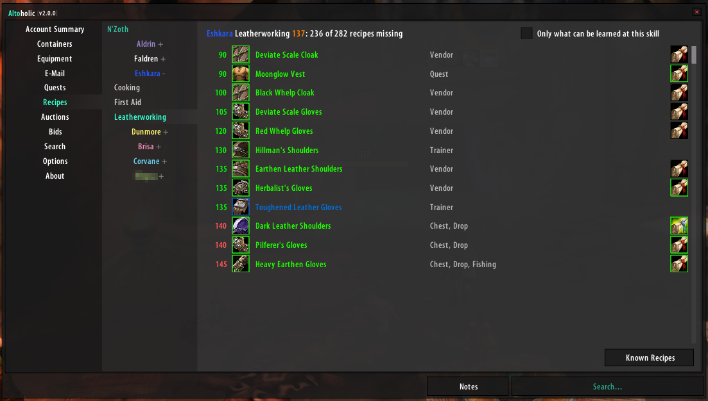
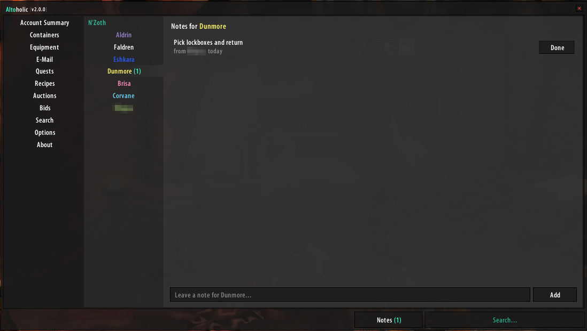
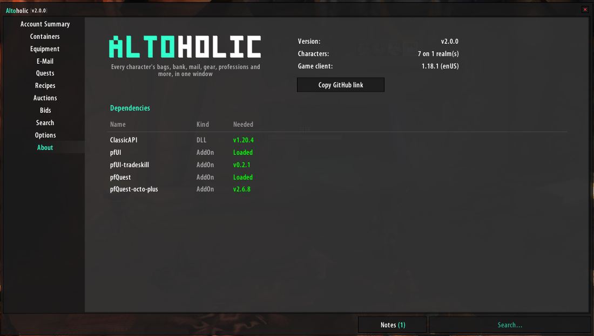

# Altoholic for OctoWoW

Altoholic records the bags, bank, mail, equipment, professions, quests, reputations and
raid lockouts of all your characters and shows them in one window.

This is an overhaul of Altoholic for OctoWoW, with a new window in pfUI's style. It builds on
Giselbaer's Turtle WoW version, which in turn is based on Dyaxler's original Altoholic for
Vanilla WoW. Thanks to both for the work this builds on; their notes are at the end of this page.

## Requirements

Starting in v2.0.0 this addon requires [ClassicAPI](https://github.com/brues-code/ClassicAPI),
a client mod that brings Lua 5.1 and parts of the modern addon API to the 1.12 client.
Without it Altoholic only shows a notice at login and leaves your saved data untouched.

These addons are optional; each adds to what Altoholic can do when it is loaded. The About
page (under Options) shows which are there.

| Addon | What it adds |
|---|---|
| [pfUI](https://github.com/brues-code/pfUI) (ClassicAPI edition) | The window takes pfUI's colours, font and borders. Without it, the window draws pfUI's default look itself. |
| [pfUI-tradeskill](https://github.com/Vaterade/pfUI-tradeskill) | Queue crafts for any character from Recipes and Search. |
| [pfQuest](https://github.com/brues-code/pfQuest) | Missing Recipes names who sells or drops a recipe and where, and shows them on the map. |
| [pfQuest-octo-plus](https://github.com/Salahaja/pfQuest-octo-plus) | OctoWoW's items and NPCs for pfQuest, so those sources match this server. |

## Installing

Install [ClassicAPI](https://github.com/brues-code/ClassicAPI) first. The addon's folder inside
`Interface/AddOns` must be named `Altoholic`, or WoW won't list it.

- With git, from your `Interface/AddOns` folder:
  `git clone https://github.com/Vaterade/Altoholic.git Altoholic`
  and `git pull` inside it to update.
- Without git, use "Code > Download ZIP" on GitHub, extract it into `Interface/AddOns` and rename
  the extracted `Altoholic-<branch>` folder to `Altoholic`.

## 2.0: a new window

The window is rebuilt from scratch in the style of [pfUI](https://github.com/brues-code/pfUI)'s
settings window: flat dark panels, a column of categories, a column of characters under
their realms, and a search box along the bottom that searches as you type. It uses no
Blizzard templates. pfUI isn't required: when it is loaded, the window takes pfUI's colours,
font and border size; without it, it draws the same look with pfUI's defaults.

- `/alto` opens and closes the window; the minimap button does too (right-click for the
  options, drag to move it).
- Equipment, Reputations and Attunements compare a realm's characters side by side; both
  factions of a realm are shown together.
- Right-click a character in Account Summary to open their pages or forget them.
- With [pfUI-tradeskill](https://github.com/Vaterade/pfUI-tradeskill) loaded, Recipes has a Queue
  button on each recipe that adds crafts to that character's task list there, and
  right-clicking a recipe in Search queues it on whoever knows it. Only characters on the
  realm you're logged in to can be given work.
- **Notes**: the Notes button beside the search box lets you leave
  notes for any character, or type `/alto note <name> <text>`. When that character logs in,
  the notes pop up; Done removes one, Later keeps them for next time.
- **Missing Recipes**: on the Recipes page, the button in the bottom right corner lists the
  recipes of that profession the character hasn't learned, by skill level, with where each
  is learned or found. The recipe list comes from LibCrafts-1.0 by Roman Kharitonov (of
  [MissingCrafts](https://github.com/refaim/MissingCrafts)), as shipped with Grom's
  Gromissingcrafts, which adds Survival (MIT, see `Items/Recipes-LICENSE.txt`). It is
  converted with `tools/convert-libcrafts.lua`. With [pfQuest](https://github.com/brues-code/pfQuest)
  loaded, hovering a recipe item names the vendors, mobs and chests it comes from and their
  zones, and clicking it shows them on pfQuest's world map.
- **About**, under Options, shows the version and which of the addons under Requirements are loaded.
  The credits are further down this page.
- The saved data is the same as 1.x, so nothing is lost when updating.

## Screenshots

The character names are made up, apart from one that is blurred.

| | |
|---|---|
|  Account Summary: every character's level, money, played time and rest |  Skills: professions and secondary skills |
|  Reputations: a realm's characters side by side |  Raids: lockouts, and when each raid resets |
|  Containers: bags, keyring, bank and bank bags |  Equipment: a realm's characters side by side |
|  Recipes, with the Queue buttons for pfUI-tradeskill |  Missing Recipes: what's left to learn, and where |
|  Notes for a character, shown when they log in |  About: the version and the dependencies |

## Commands

- `/alto` opens and closes the window.
- `/alto search <item>` searches your characters' bags, bank and mail for an item, for example
  `/alto search primal mana`.
- `/alto note <name> <text>` leaves a note for one of your characters on this realm.

## Credits

Altoholic 2.0 is built on the work of these addons and people:

| Who | What Altoholic uses |
|---|---|
| Thaoky | Altoholic, the original addon (2.4.015), which all of this grew from |
| Dyaxler | Altoholic for Vanilla WoW, the backport to 1.12 |
| Giselbaer | The Turtle WoW version: raid lockouts, attunements, completed quests |
| brues-code | ClassicAPI, the DLL Altoholic is built on; pfUI (the ClassicAPI edition), whose look and settings window the 2.0 window follows; and pfQuest, for the vendors, drops and map pins in Missing Recipes |
| Salahaja & The Iron Hammers | pfQuest-octo-plus, OctoWoW's item and NPC database |
| Roman Kharitonov (refaim) | LibCrafts-1.0 from MissingCrafts: the recipe list for Missing Recipes (MIT) |
| Grom | Gromissingcrafts: the Survival recipes, and the copy of the recipe list used (MIT) |
| AtlasLoot | The loot tables behind the loot and upgrade searches (AtlasLoot 4.05) |

## Earlier versions

The notes below are from the earlier versions this fork builds on, in their authors' words.
They describe Altoholic 1.x and its old window; some details no longer apply to 2.0.

### Giselbaer's changes

This version fixes several bugs, improves some things, and adds a menu tab to show
Raid lockouts and reset times.

If you have several accounts, or cleared your WDB folder, a character might not know
some of the items in the auction/bid lists, which lead to crashes. Now those items
are shown as blank squares and requested from the server for future display.

Character lists are sorted by character level backwards, then name. So your level 60's
are always on top, and your level 1 bank characters are always on bottom.

The new character sort order also fixes the problem that sometimes clicking on a character
made a different character pop up (caused by LUA tables not preserving order).

The quest log messed up after a while, making quests show as header lines.

Reputations and Equipment are now limited to your 10 highest character; this was a problem
if you had more than 10 characters when you had more than 1 account.

Profession skills are shown with their first letter now, so "Jewelcrafting 300" shows as
"J300", not 300, which makes it easier to find a skill.

A new tab shows which characters have raid lockout IDs for which raid.
This includes reset times which are shown when you hover over a raid name in the title,
no more reason to tab out and use the (excellent!) turtle timers.

Added several Turtle specific factions to the factions list.

### Raid Module

A new module shows the raid IDs for your characters and their expiration times.
Hovering the mouse over a header shows the last reset and next reset times
for that raid, it also shows the next reset date as day of the week. So it's easy
for you to determine if you can go raid today when you need the ID for a
guild raid on saturday.

### Attunements Module

This module helps you to remember which of your character has dungeon keys,
completed attunement quests, and turned in one-time items (Onyxia head,
Hakkar heart etc.). It checks if you have done the corresponding quest, so it
also answers the question "has this character that I haven't played in half a
year done its BWL attunement or not?".

For dungeons, it checks quests as well, like whether or not you have done the
Scepter of Celebras quest for Maraudon or the Key to Scholomance. As the module
can only check quests, it will not tell you about the scarlet key or the Dire
Maul key.

As I don't know much about the higher tier raid, I'm open to suggestions as to
what other items/quests to include. A link to the corresponding quest on 
database.turtle-wow.org would be great if you want an addition here.

### Dyaxler's notes

Altoholic for Vanilla WoW 1.12 - backported from version 2.4.015 originally written by Thaoky

*Please Note:*
- Please use the <a href="https://github.com/Dyaxler/Altoholic_Vanilla/issues">issue tracker</a> to report bugs!

Features:

- Language supported: English and French. Although it's not fully localized for frFR, it does run well on French clients (my guildmates made sure of this :D). More languages will come soon, I'm using the LibBabble libraries more & more.

- Account-wide data summary:
	- Characters' talents: only a summary, not a full buid, I may implement this later on if there's demand.
	- Money, /played, rest xp for each character, subtotals by realm, and grandtotals for the account.
	- Bag usage: see at a glance which characters should get bigger bags (bag size, free slots and types included)
	- Characters' skills: skill summary on one screen, namely the 2 main professions + the 3 secondary skills as well as riding. I may add more if there's demand.
	- Reputations: a list of all the reputations of the current realm's characters. This screen will get some love in the future, but it's perfectly functional. You can see at a glance if all your alts are at least honored with Honor Hold if you want to get the new 2.4 blue PVP set.

- View containers (bags, bank, keyring) of all alts, on all realms.

- Guild banks : You have 10 alts in 10 different guilds on the same server, all of them with access to a guild bank ?
Not a problem, you can see them all here.

- E-mail: allows you to see which alts have mail without having to reconnect them. The addon will tell you when mail is about to expire on a character. Threshold configurable (up to 15 days). Multiple realm support as well. Mails sent to a known alt (one you've logged on at least once) will be visible in the addon.

- Equipment: See the equipment of the current realm's alts in one screen. Very useful when purchasing stuff for your alts at the AH.

- Options: the option screen is still a bit minimal, I'll add more options along the way depending on user requests.

- Search: the most important feature of the addon, it uses an AH-like frame to display search results. You can either search bags on the current realm, on all realms, or a loot table.
The loot table is a table based on AtlasLoot 4.04 which contains only item id's, and therefore keeps memory usage minimal.
As an indicator, with 10 alts (+bank) + guild bank + loot table, the addon only takes 2.3 mb of memory. The addon has gained weight since the integration of some libraries, but this will ensure support for multiple languages in the future. I expect to support deDE soon.

The Search menu allows you to find items based on their name (even partial), level, type or rarity, almost like at the AH.
